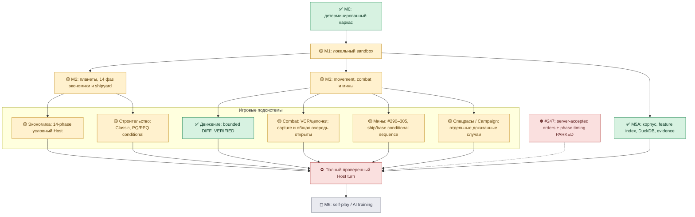
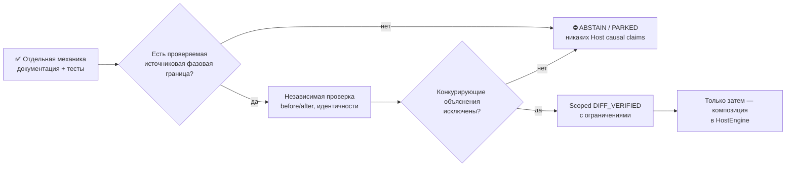

# Карта прогресса planets-lab

> Актуализировано 24 октября 2026 года для PR **#301**. Источник — `main` до PR #301 (`8feba1d956283826fc3db177f2993e1da523e9b9`), [ROADMAP](ROADMAP.md), [COMPILED_CORPUS](COMPILED_CORPUS.md) и [handoff](CONTINUE_HERE.md). После PR проверить фактический HEAD и CI заново.
>
> **Здесь нет одного общего процента.** Процент «знаем формулу» не равен проценту «Host воспроизведён». Эта страница отдельно показывает наличие кода, силу свидетельств и интеграционные пробелы. Старые оценки 2026-09-11 в ROADMAP — исторический снимок, не актуальные KPI.

> **Обновление PR #302 (2026-10-24):** добавлен условный [аудит полного transition roster](handoff/2026-10-24-isolated-decay-web-phase-pair-audit-v1.md), связывающий #290 mine decay и #301 PRE/POST web envelope. Это повышает **целостность синтетического фазового контракта**, но **НЕ** evidence tier: никаких принятых Host orders, real phase receipts или новых DIFF_VERIFIED результатов. Любые архивные T-1→T данные остаются непригодны как доказательство соседства фаз без независимой аутентификации.

> **Обновление PR #303 (2026-10-24):** [машинно-читаемый source-readiness gate](handoff/2026-10-24-mine-phase-source-readiness-manifest-v1.md) возвращает устойчивые причины, почему `T-1/T` и client-save недостаточны для Host-phase proof. Для внешне заявленного phase receipt выводится `NEEDS_INDEPENDENT_AUTHENTICATION`, а не `DIFF_VERIFIED`. Это развитие **инструмента проверки provenance**, НЕ новый verified Host-механизм и не изменение процента готовности симулятора.

> **Обновление PR #304 (2026-10-24):** [Campaign starbase sweeping](handoff/2026-10-24-campaign-starbase-mine-sweep-quote-v1.md) добавляет РЕАЛЬНУЮ ПО ПОСТАНОВКЕ ЗАДАЧИ, но лишь **условно рассчитанную** игровую механику: все лучи защиты планеты и базы при подтверждённом Sweep Mines, статус ДОКУМЕНТИРОВАНО+СИНТЕТИЧЕСКИ ТЕСТИРУЕТСЯ. Никакого нового CORPUS_OBSERVED/DIFF_VERIFIED, полноценной фазовой композиции и выпуска IntelBoard. Ранее общий mine lifecycle #290–303; теперь #290–304.

> **Обновление PR #305 (2026-10-24):** добавлен [двухэтапный условный расчёт](handoff/2026-10-24-ship-to-starbase-conditional-sweep-ledger-v1.md) **корабельные лучи → одна Campaign starbase**, с общей ведомостью мин, пересчётом радиусов и проверкой баланса всех ступеней. Это реальный прогресс **по инженерной композиции** относительно разрозненных котировок #293/#304, но НЕ подтверждение реального исполнения NuHost: MSC/fighters/multi-base/Host-order capture исключены, evidence остаётся DOCUMENTED+TESTED synthetic.

## 1. Общая схема работ

Обозначения: ✅ реализовано и подтверждено **в указанном ограниченном scope**; 🟡 существует существенный код, но остаётся неполная интеграция или свидетельства; ⛔ нельзя продвигать без нового независимого источника; ◻ поздний этап. Все зелёные точки относятся к **узкой области**, а не к полному NuHost.

**Внешний продукт:** PlanetDashboard/IntelBoard — отдельный frontend/backend deployment и иная продуктовая дорожная карта; эта схема не заявляет, что его UI-функции, авторизация или деплой перепроверены в `planets-lab`. Его интеграция потребует отдельного release и политики доступных/выведенных данных.

## 2. Матрица зрелости по категориям

| Направление | Реализация / локальные тесты | Независимые свидетельства | Ключевой незакрытый шаг |
|---|---|---|---|
| **M0 / M1 — ядро и sandbox** | Детерминированный skeleton, локальный sandbox — существенно развиты | Программные тесты/инфраструктура | Собрать полное host-поведение с корректным порядком фаз |
| **M2 — планеты, экономика** | 14-phase и условные многоходовые модели, минералы, налоги, starbase, warehouses | M2 conditional/corpus residual наблюдения, без причинного Host-boundary | Подтвердить состояние до/после принятого Host-приказа, owner inventory |
| **Строительство / очереди** | Classic pointer/PBP, early/late PQ/PPQ, многобазовая BOM-сборка, PP sidecars | #289 PPQ 6 игр: 48 коррелированных окон, 17/17 unique prior-base hull+engine сопоставлений, 5 ABSTAIN — только **CORPUS_OBSERVED** | Доказать причинность сборки, accepted orders, фактический порядок слотов |
| **Movement / Tow / Fuel** | Ordinary movement/geometry/warp wells, finite-fuel Tow, partial fuel, mine hit contexts | Отдельные **CORPUS_OBSERVED + TESTED + DIFF_VERIFIED** границы для partial-fuel и finite-fuel Tow | Сложные сцепленные tow/chain/mission, campaign, full-turn sequencing |
| **Combat / VCR** | Pairwise, ordinary ship/planet/starbase sequences, selected predictive queue | Ограниченные differential/corpus результаты; 22/22 held-out next-VCR в отмеченном scope; capture остаётся открытым | Полная очередь боя/стороны/capture, комплексная последовательность |
| **Minefield lifecycle** | #290–305: decay, unallocated torp, placement candidate, beam/fighter sweep, MSC, overlap/conflict witness, impact & web fuel/drain; #301 общий phase-aware геометрический guard | **DOCUMENTED + TESTED synthetic only**; независимой Host-проверки фаз нет | Конфликты и числовые потери, фактические IDs, edge raster, фазовый состав и принятые приказы |
| **Race/Campaign abilities** | Селективные эффекты, Федерация, Crystal/Robot/Colonial в узких модулях; Horwasp research существует | Ограниченные свидетельства в handoffs; **Horwasp PAUSED** | Полное покрытие races/advanced scenarios, guard от custom |
| **M5A — корпус/данные** | `CURRENT` public68, manifest/feature index, compiled L1/L2, типизированный DuckDB, runtime evidence | Реальный source-verified runtime, provenance, CI; prepared public100 >26GiB подготовлен | Не трогать sealed M2 heldout32, не перестраивать public100 без отдельного основания |
| **M5B — Nu compatibility** | Узкие movement/combat differential gates | Квалифицированные scoped DIFF/observations, без всеобъемлющего coverage | Переход от частных механик к полному NuHost state+orders |
| **Host turn end-to-end** | Архитектура и отдельные составные conditional модели | **НЕ DIFF_VERIFIED** как полный движок | Issue **#247 PARKED**: точные server-accepted orders/phase witness |
| **M6 — self-play / AI** | Исследовательское направление/план | Нужен надёжный Host/observer surface прежде чем обучать | Поздний milestone после достаточной fidelity |
| **PlanetDashboard / IntelBoard** | Внешнее приложение со своим UI/API roadmap | **Не оценено** как release в этом source-only PR | Отдельный продуктовый review/deployment, не путать с симулятором |

Уровни доказательств `DOCUMENTED`, `TESTED`, `CORPUS_OBSERVED`, `DIFF_VERIFIED` **не являются взаимозаменяемыми ступенями**. Совпадение с архивным наблюдением не гарантирует причинное воспроизведение Host; `TESTED` подтверждает поведение кода, но не обязательно соответствие движку. В частности, 17/17 prior-base matches НЕ означают 17 доказанных Host-build.

## 3. Маршрут к следующей цели

### Рабочие приоритеты

1. **Теперь:** #301 — общий консервативный `PRE_DECAY` / `POST_DECAY` web radius envelope, не widening truth; дедубликация guards beam sweep и Crystal web drain. Действительный exact cell/square anchor всё ещё неизвестен, ближняя зона остаётся ABSTAIN.
2. **Далее:** независимый публичный источник для точной web edge/square растеризации или ограниченный diagnostics/ABSTAIN-first geometry proof; не делать вид, что `radius + 2` — действительная дальность NuHost.
3. **После:** source-qualified реальная фаза Host/countermining с полным pre/post snapshot; только новое исследование с заранее замороженной гипотезой, tracked one-command `tools/run-*-with-evidence.sh` через `tools/run-with-runtime-evidence.sh`, sanitized `runtime-logs` даже ABSTAIN.
4. **Крупные дальнейшие вехи:** combat capture/full engagement; causal planetary and queue orders; cross-phase integration; visibility/observer; AI self-play. #247 остаётся PARKED без запроса частных captures.

## Правила обновления этой карты

При существенном изменении статуса отдельного направления обновляй **обе** оси: (а) реализацию, (б) источник и уровень доказательств. Не проставляй общий процент готовности без знаменателя и audit scope. Сохранить read-only границы `CURRENT=public68`, `prepared public100`, `sealed heldout32`, frozen #289 и #247 PARKED. Для каждого PR отдельно обязательны полный `CONTINUE_HERE.md`, numbered `PR_CHANGELOG.md`, topic docs, CI exact HEAD и post-merge `main`.
