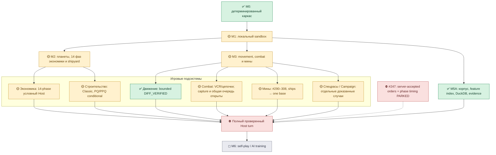
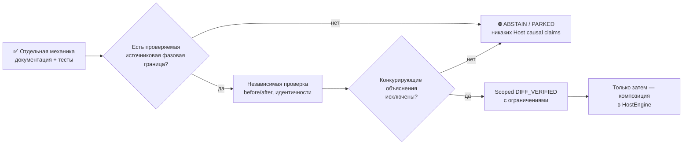

# Карта прогресса planets-lab

> Первоначальная карта создана PR **#301**, последний раздел обновлён для **PR #316** (24 октября 2026). Источники: живой `main`, [ROADMAP](ROADMAP.md), [COMPILED_CORPUS](COMPILED_CORPUS.md), [handoff](CONTINUE_HERE.md). Для актуального HEAD и CI всегда обращайся к GitHub; пин SHA из старого PR не является текущим состоянием.
>
> **Здесь нет одного общего процента.** Процент «знаем формулу» не равен проценту «Host воспроизведён». Эта страница отдельно показывает наличие кода, силу свидетельств и интеграционные пробелы. Старые оценки 2026-09-11 в ROADMAP — исторический снимок, не актуальные KPI.

> **Обновление PR #316 (2026-10-24):** #315 реально merged (`main=500192c1f950f0012ee61820c4f3b378bc14188d`, PR CI #1752/main CI #1753 SUCCESS). Отдельные маргинальные v5 счётчики 138864 fresh own и 536703 stable-centre changed units не дают истинного пересечения (границы 0..138864). В #316 реализовано **совместное по одной записи** строгое условие с учётом направления изменения количества мин и консервационными проверками, плюс самостоятельный read-only runner v6 с 68-game allowlist/8550 frozen pairs и автоматической публикацией в `runtime-logs`. **Это прогресс инструментария, а НЕ новое эмпирическое наблюдение:** запуск v6 ещё не выполнен; Host accepted orders/phase receipts не получены, `DIFF_VERIFIED` не повышается. [Технический handoff](handoff/2026-10-24-minefield-fresh-stable-units-joint-v6.md).

> **Обновление PR #302 (2026-10-24):** добавлен условный [аудит полного transition roster](handoff/2026-10-24-isolated-decay-web-phase-pair-audit-v1.md), связывающий #290 mine decay и #301 PRE/POST web envelope. Это повышает **целостность синтетического фазового контракта**, но **НЕ** evidence tier: никаких принятых Host orders, real phase receipts или новых DIFF_VERIFIED результатов. Любые архивные T-1→T данные остаются непригодны как доказательство соседства фаз без независимой аутентификации.

> **Обновление PR #303 (2026-10-24):** [машинно-читаемый source-readiness gate](handoff/2026-10-24-mine-phase-source-readiness-manifest-v1.md) возвращает устойчивые причины, почему `T-1/T` и client-save недостаточны для Host-phase proof. Для внешне заявленного phase receipt выводится `NEEDS_INDEPENDENT_AUTHENTICATION`, а не `DIFF_VERIFIED`. Это развитие **инструмента проверки provenance**, НЕ новый verified Host-механизм и не изменение процента готовности симулятора.

> **Обновление PR #304 (2026-10-24):** [Campaign starbase sweeping](handoff/2026-10-24-campaign-starbase-mine-sweep-quote-v1.md) добавляет РЕАЛЬНУЮ ПО ПОСТАНОВКЕ ЗАДАЧИ, но лишь **условно рассчитанную** игровую механику: все лучи защиты планеты и базы при подтверждённом Sweep Mines, статус ДОКУМЕНТИРОВАНО+СИНТЕТИЧЕСКИ ТЕСТИРУЕТСЯ. Никакого нового CORPUS_OBSERVED/DIFF_VERIFIED, полноценной фазовой композиции и выпуска IntelBoard. Ранее общий mine lifecycle #290–303; теперь #290–304.

> **Обновление PR #305 (2026-10-24):** добавлен [двухэтапный условный расчёт](handoff/2026-10-24-ship-to-starbase-conditional-sweep-ledger-v1.md) **корабельные лучи → одна Campaign starbase**, с общей ведомостью мин, пересчётом радиусов и проверкой баланса всех ступеней. Это реальный прогресс **по инженерной композиции** относительно разрозненных котировок #293/#304, но НЕ подтверждение реального исполнения NuHost: MSC/fighters/multi-base/Host-order capture исключены, evidence остаётся DOCUMENTED+TESTED synthetic.

> **Обновление PR #306 (2026-10-24):** [один Colonial mixed carrier](handoff/2026-10-24-colonial-simultaneous-mixed-sweep-v1.md) теперь синтетически совмещает fighter sweep и beam sweep **одновременно в рамках одного Ship-ID шага**. Для Ion Storm fighter работает, beam блокируется; web иммунны к fighter, beam web остаётся near-edge ABSTAIN. Суммарные минные потери ограничены количеством мин и не приписываются конкретному каналу без доказательства. Это развитие кода, **не** новая Host DIFF_VERIFIED проверка. Mine mechanisms #290–306.

> **Обновление PR #307 (2026-10-24):** [ID-ordered canonical ship sweeping](handoff/2026-10-24-ordered-canonical-ship-sweep-ledger-v1.md) даёт единую условную ведомость для beam-only, Colonial fighter-only и Colonial mixed кораблей, отсортированных по **общему Ship ID**, с перерасчётом радиусов и сохранением mine units по шагам. Это **расширение синтетической композиции**, не новый `CORPUS_OBSERVED`/ `DIFF_VERIFIED`. MSC, Campaign starbase, multiple Host phases и реальные accepted orders НЕ подключены. Mine lifecycle #290–307.

> **Обновление PR #308 (2026-10-24):** [единая условная очередь](handoff/2026-10-24-canonical-ships-one-campaign-starbase-ledger-v1.md) теперь связывает три **взаимоисключающих** ship sweeper режима по возрастанию ID с **одной** Campaign starbase после всех кораблей. Учитывается общий исходный roster, полные исходные карты владельцев/ion/web/Colonial, изменение радиусов и строгий сквозной баланс, плюс parity со старым #305 beam-only ledger. **Инженерная композиция** повышена, **доказательный уровень не повышен**: DOCUMENTED+TESTED synthetic conditional, НЕ реальная Host-фаза / DIFF_VERIFIED. MSC и несколько баз остаются открытыми.

> **Обновление PR #309 (2026-10-24):** подготовлен [одноразовый массовый read-only проход по публичной базе CURRENT/public68](handoff/2026-10-24-public68-maximal-readonly-batch-v1.md): все 68 игр и 169569 опубликованных source members, integrity SHA256, temporal/member/typed census, восьмикатегорийная source-readiness, полный локальный pytest и automatic **sanitized** `runtime-logs`. Это пока **подготовленный инструмент** (не уже проведённое исследование), после запуска уровень результатов будет лишь **CORPUS_OBSERVED / descriptive source coverage**, а **не** Host-phase `DIFF_VERIFIED`. public100, sealed M2, private orders and immutable CURRENT не меняются.

> **Обновление PR #310 (24.10.2026):** подготовлен [полноценный единый read-only batch для public100](handoff/2026-10-24-public100-baseline68-deep-batch-v2.md): metadata всех 100 игр, содержательные owner-current M2 проверки только по базовым 68 играм (до 1088 соседних пар), полный pytest с публикацией только агрегированных кодов ошибок. Закрытые 32 игры не используются для реконструкции игровых состояний, CURRENT не переключается. Этот код ещё НЕ означает состоявшийся проход на сервере и НЕ даёт Host DIFF_VERIFIED.

> **Обновление PR #311 (24 октября 2026):** [безопасный допуск к подробной public100/baseline68 выборке](handoff/2026-10-24-public100-baseline-cohort-identity-v3.md) усилен после runtime ABSTAIN из-за устаревшего SHA manifest. Теперь exact game-ID-set из локального manifest обязан совпасть с independently SHA-pinned public68 metadata и быть подмножеством public100; actual manifest bytes закрепляются до M2 decode. Никакая игра из sealed32 не может попасть в содержательный анализ из-за простого совпадения счётчика 68. Этот PR исправляет инструмент, **нового измерения CORPUS_OBSERVED или Host DIFF_VERIFIED пока нет**.

> **PR #312 (24.10.2026), implementation axis:** подготовлен новый [долгий источник-ограниченный M2 + архивные не-планетные секции](handoff/2026-10-24-public100-baseline68-expanded128-multifamily-v4.md) для **до 8704** детерминированно выбранных baseline68 T−1/T пар (128/игру вместо16), плюс анонимная диагностика пяти реально обнаруженных серверных падений pytest. **Evidence axis пока не повышается:** после host-run возможен только CORPUS_OBSERVED descriptive, но НЕ независимое Host DIFF_VERIFIED. Точные параметры source-census: 100 игр metadata, content 68 игр, sealed32 untouched.

> **PR #313 (24.10.2026), новый подтверждённый on-host слой:** реальный [v4 анализ 8550 пар](handoff/2026-10-24-public100-v4-runtime-and-docker-git-root-cause-v1.md) завершён за 27м54с, 317255 свежих same-owner planetary comparisons и ненормализованные по перспективам записи ships/mines/starbases/VCR/ion. Расширилась **ось CORPUS_OBSERVED (покрытие источника)**, не **DIFF_VERIFIED (изолированное выполнение Host)**. Ошибки **5 из 3697** pytest тестов локализованы по двум тестовым модулям; PR добавляет отсутствующий в Docker образе Git и реальное Docker smoke в CI. Никакого новейшего Host order causality, публичные source snapshots не фазовые receipts.

> **Обновление PR #314 (24 октября 2026):** технически добавлен [строгий source-readiness audit без приписывания Host причинности](handoff/2026-10-24-frozen-archive-nonplanet-identity-readiness-v1.md) для тех же 8550 T−1/T baseline68 пар: уникальность `id` на обеих сторонах, устойчивость/смена владельца, точный `ownerid+infoturn` у своих записей, для мин только типизированные наблюдаемые `units` с неизменным owner/center; при дублях/неизвестной свежести ABSTAIN. Population SHA фиксируется **до** восстановления реальных записей, а не постфактум. **Evidence axis не изменилась:** #312 8550 архивных пар — CORPUS_OBSERVED; новый v5 runtime ещё НЕ выполнялся, реальная Host-фаза/принятые приказы и DIFF_VERIFIED недоступны.

> **Результат PR #315 (24.10 UTC / 25.10 локально):** реальный [v5 серверный аудит](handoff/2026-10-24-v5-nonplanet-source-readiness-evidence-review-v1.md) завершился успешно за 32м22с, 3707 pytest cases / 0 failures (26 skipped), всё ещё **8550** исходных архивных пар из baseline68, 100 игр только metadata, 32 sealed не вскрывались. По источнику minefields 887224 same-ID, 138864 own-current, 536703 stable-owner/center changed-units; эти числа являются *разными маргинальными счётчиками*, их пересечение не наблюдалось и математически **0..138864**. У VCR 0 межходовых совпадений ID, у starbases 346222 ID совпадений, но ownership untyped, storms owner gate неприменим; это не баг механики Host. В код добавлена [машинная scorecard](../validation/research/public100-baseline68-nonplanet-v5-source-readiness.v1.json), отдельно показывающая пригодность источника и невозможность Host causal attribution. **Implementation/source evidence усилились, DIFF_VERIFIED НЕ повысился.**

## 1. Общая схема работ

Обозначения: ✅ реализовано и подтверждено **в указанном ограниченном scope**; 🟡 существует существенный код, но остаётся неполная интеграция или свидетельства; ⛔ нельзя продвигать без нового независимого источника; ◻ поздний этап. Все зелёные точки относятся к **узкой области**, а не к полному NuHost.

**Внешний продукт:** PlanetDashboard/IntelBoard — отдельный frontend/backend deployment и иная продуктовая дорожная карта; эта схема не заявляет, что его UI-функции, авторизация или деплой перепроверены в `planets-lab`. Его интеграция потребует отдельного release и политики доступных/выведенных данных.

## 2. Матрица зрелости по категориям

| Направление | Реализация / локальные тесты | Независимые свидетельства | Ключевой незакрытый шаг |
|---|---|---|---|
| **M0 / M1 — ядро и sandbox** | Детерминированный skeleton, локальный sandbox — существенно развиты | Программные тесты/инфраструктура | Собрать полное host-поведение с корректным порядком фаз |
| **M2 — планеты, экономика** | 14-phase и условные многоходовые модели, минералы, налоги, starbase, warehouses | M2 conditional/corpus residual наблюдения, без причинного Host-boundary | Подтвердить состояние до/после принятого Host-приказа, owner inventory |
| **Строительство / очереди** | Classic pointer/PBP, early/late PQ/PPQ, многобазовая BOM-сборка, PP sidecars | #289 PPQ 6 игр: 48 коррелированных окон, 17/17 unique prior-base hull+engine сопоставлений, 5 ABSTAIN — только **CORPUS_OBSERVED** | Доказать причинность сборки, accepted orders, фактический порядок слотов |
| **Movement / Tow / Fuel** | Ordinary movement/geometry/warp wells, finite-fuel Tow, partial fuel, mine hit contexts | Отдельные **CORPUS_OBSERVED + TESTED + DIFF_VERIFIED** границы для partial-fuel и finite-fuel Tow | Сложные сцепленные tow/chain/mission, campaign, full-turn sequencing |
| **Combat / VCR** | Pairwise, ordinary ship/planet/starbase sequences, selected predictive queue | Ограниченные differential/corpus результаты; 22/22 held-out next-VCR в отмеченном scope; capture остаётся открытым | Полная очередь боя/стороны/capture, комплексная последовательность |
| **Minefield lifecycle** | #290–308: decay, unallocated torp, placement candidate, beam/fighter sweep and combined ID-ordered three ship modes → one Campaign base, separate exact MSC quote, overlap/conflict witness, impact & web fuel/drain; #301 phase-aware geometry guard | **DOCUMENTED + TESTED synthetic only**; независимой Host-проверки фаз нет | Конфликты и числовые потери, фактические IDs, edge raster, фазовый состав и принятые приказы |
| **Race/Campaign abilities** | Селективные эффекты, Федерация, Crystal/Robot/Colonial в узких модулях; Horwasp research существует | Ограниченные свидетельства в handoffs; **Horwasp PAUSED** | Полное покрытие races/advanced scenarios, guard от custom |
| **M5A — корпус/данные** | `CURRENT` public68, manifest/feature index, compiled L1/L2, типизированный DuckDB, runtime evidence | Реальный source-verified runtime, provenance, CI; prepared public100 >26GiB подготовлен | Не трогать sealed M2 heldout32, не перестраивать public100 без отдельного основания |
| **M5B — Nu compatibility** | Узкие movement/combat differential gates | Квалифицированные scoped DIFF/observations, без всеобъемлющего coverage | Переход от частных механик к полному NuHost state+orders |
| **Host turn end-to-end** | Архитектура и отдельные составные conditional модели | **НЕ DIFF_VERIFIED** как полный движок | Issue **#247 PARKED**: точные server-accepted orders/phase witness |
| **M6 — self-play / AI** | Исследовательское направление/план | Нужен надёжный Host/observer surface прежде чем обучать | Поздний milestone после достаточной fidelity |
| **PlanetDashboard / IntelBoard** | Внешнее приложение со своим UI/API roadmap | **Не оценено** как release в этом source-only PR | Отдельный продуктовый review/deployment, не путать с симулятором |

Уровни доказательств `DOCUMENTED`, `TESTED`, `CORPUS_OBSERVED`, `DIFF_VERIFIED` **не являются взаимозаменяемыми ступенями**. Совпадение с архивным наблюдением не гарантирует причинное воспроизведение Host; `TESTED` подтверждает поведение кода, но не обязательно соответствие движку. В частности, 17/17 prior-base matches НЕ означают 17 доказанных Host-build.

## 3. Маршрут к следующей цели

### Рабочие приоритеты

1. **Теперь:** #301 — общий консервативный `PRE_DECAY` / `POST_DECAY` web radius envelope, не widening truth; дедубликация guards beam sweep и Crystal web drain. Действительный exact cell/square anchor всё ещё неизвестен, ближняя зона остаётся ABSTAIN.
2. **Далее:** независимый публичный источник для точной web edge/square растеризации или ограниченный diagnostics/ABSTAIN-first geometry proof; не делать вид, что `radius + 2` — действительная дальность NuHost.
3. **После:** source-qualified реальная фаза Host/countermining с полным pre/post snapshot; только новое исследование с заранее замороженной гипотезой, tracked one-command `tools/run-*-with-evidence.sh` через `tools/run-with-runtime-evidence.sh`, sanitized `runtime-logs` даже ABSTAIN.
4. **Крупные дальнейшие вехи:** combat capture/full engagement; causal planetary and queue orders; cross-phase integration; visibility/observer; AI self-play. #247 остаётся PARKED без запроса частных captures.

## Правила обновления этой карты

При существенном изменении статуса отдельного направления обновляй **обе** оси: (а) реализацию, (б) источник и уровень доказательств. Не проставляй общий процент готовности без знаменателя и audit scope. Сохранить read-only границы `CURRENT=public68`, `prepared public100`, `sealed heldout32`, frozen #289 и #247 PARKED. Для каждого PR отдельно обязательны полный `CONTINUE_HERE.md`, numbered `PR_CHANGELOG.md`, topic docs, CI exact HEAD и post-merge `main`.
